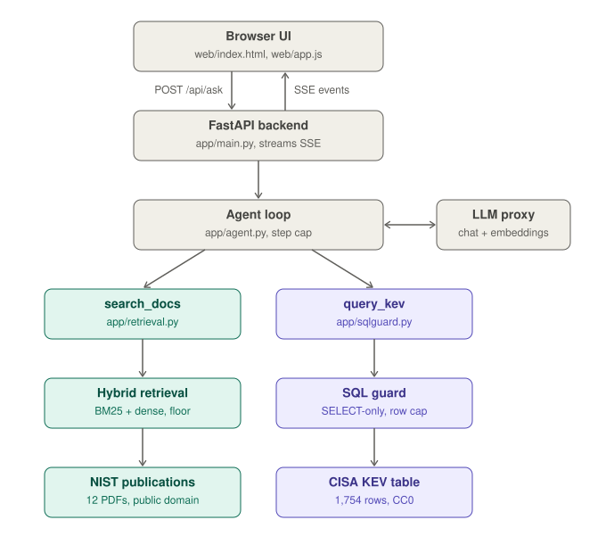

# Cyber Advisor

An LLM assistant that answers security questions **from sources it can cite** and from a **table it can query exactly**:

* **Documents** - 12 NIST publications (incident response, patch management, risk, logging, zero trust, malware, container security, ...), searched with BM25 + embeddings and cited as `[n]` with document and page.
* **A table** - CISA's Known Exploited Vulnerabilities (KEV) catalog, 1 754 rows. Counting, ranking and date questions go to **guarded text-to-SQL**, because a vector search over rows cannot count.

A small tool-calling agent decides which source a question needs (or both, or neither) and declines what the sources cannot answer.

> Built for the KMITL *Building LLM-Powered Applications* capstone. It is **not** the course reference app (`kmitl-llm-app-demo`): different domain, a table + SQL tool, a hand-built 36-question evaluation with baselines, and a chunk-level retrieval metric. See [How this differs from the reference app](#how-this-differs-from-the-reference-app).



Teal is the document path (NIST publications); purple is the table path (CISA KEV). The agent may take either, both, or neither.

## Run it

Requires Python 3.11+ and [uv](https://docs.astral.sh/uv/). The data is committed, so no download is needed.

```bash
uv sync
cp .env.example .env            # then put your course key in OPENAI_API_KEY (never commit .env)
uv run python -m app.ingest     # embed the ~2 900 chunks once (needs the key; ~20 min: the class proxy embeds ~2.5 chunks/s)
uv run uvicorn app.main:app --port 8000     # open http://localhost:8000
uv run pytest -q                # 80 tests; need no key and no network
```

Embeddings are cached on disk (`data/index/embed_cache.db`), so an interrupted `ingest` resumes. `scripts/fetch_data.py` re-downloads everything (`--force` refreshes the KEV snapshot - which changes weekly, so the committed snapshot is what the evaluation gold refers to).

## What each part is for (course lecture in brackets)

| File | Role |
|---|---|
| `app/llm.py` | the only place a model is called: `chat()` and `embed()` through the class proxy; key and base URL from the environment [L1-L4] |
| `app/schemas.py` | Pydantic models for the request, tool arguments and the final answer envelope [L2] |
| `app/main.py`, `web/` | FastAPI + Server-Sent Events backend and a no-build UI [L3-L4] |
| `app/chunking.py`, `app/index.py`, `app/retrieval.py`, `app/bm25.py`, `app/embcache.py` | chunking strategies, vector index, BM25, hybrid (reciprocal rank fusion), `min_score` floor, on-disk embedding cache [L5-L8] |
| `app/kevdb.py`, `app/sqlguard.py` | the KEV table and the guard around model-written SQL [L9, L11] |
| `app/tools.py`, `app/agent.py` | the two tools, the allow-listed dispatcher and the agent loop [L10-L11] |
| `eval/` | labelled test set, metrics, a reference-guided LLM judge, and the runner [L8] |
| `tests/` | unit + in-process API tests with a scripted fake model (no key needed) |

## Safety: where untrusted data crosses a boundary

| Boundary | What is untrusted | Control |
|---|---|---|
| browser -> API | the question | Pydantic length/shape limits (422 before any code runs) |
| model -> tools | tool name, arguments | tool-name allow-list per mode; JSON parse; Pydantic schema; `dispatch()` returns an error *string*, never raises |
| model -> database | the SQL | SQLite **authorizer** (engine-level allow-list: SELECT, table `kev`, plain functions; recursive CTEs refused), `PRAGMA query_only`, one statement, 2 000 chars, 2 s timeout, 50-row cap |
| tools -> model | document text, SQL results | fenced as `<tool_result trust="untrusted-data">`; the system prompt says results are data, never instructions |
| model -> user | citations | `[n]` markers are checked against what our code actually retrieved; an invented one is flagged, never shown as a source |
| config | the API key | read from the environment only; `/api/health` reports *whether* it is set, never the value |

The SQL guard is tested against `DROP`, `ATTACH`, `PRAGMA`, `sqlite_master`, stacked statements, recursive CTEs, and writes hidden behind a `WITH` (`tests/test_sqlguard.py`). In a server database the equivalent strongest layer is a read-only role with `SELECT` on the one allowed table.

## Evaluation

**Test set** - `eval/dataset.jsonl`, 36 questions, each with a machine-checkable gold:

| type | n | gold |
|---|---|---|
| `doc` - answerable from the NIST documents | 12 | an *evidence phrase* that must appear in a retrieved chunk; a fact the judge looks for in the answer |
| `sql` - answerable from the KEV table | 11 | gold SQL (execution match) and the value(s) the answer must contain |
| `mixed` - needs both | 6 | both of the above |
| `oos` - must be declined (3 off-topic, 2 near-domain traps, 1 prompt-injection, 1 Thai) | 7 | refusal |

`uv run python -m eval.run_eval check` proves the set is sound (gold SQL runs, every evidence phrase exists in the document it names). Every item still carries `"reviewed": false` - **verify each gold by hand and flip it**; you must be able to defend every number.

**Metrics.** Retrieval is scored at *chunk* level: does a retrieved chunk contain the evidence phrase (Hit@k, MRR)? Document-level recall cannot see chunking at all - it is 1.00 for every configuration below. End to end, a question is **correct** when the answer the user sees is right (document facts: a YES/NO judge against the reference sentence; table facts: the gold value is in the answer), and **verified** when it is also backed by retrieved evidence or an executed query that matches the gold result. Judging the answer, not the machinery, lets the bare-model baseline be right or wrong instead of zero by construction.

Reproduce everything: `uv run python -m eval.run_eval {check | retrieval | floor | agent --modes ... --tag ...}`. The configuration comes from `.env` / the environment; results land in `eval/results/`.

## Results

All numbers: 36 questions, `gemma-4-E4B-it` at temperature 0 through the class proxy, KEV snapshot 2026-10-20. Small sample - one question is 3-6 points.

### 1. Retrieval: which method finds the evidence? (18 doc + mixed questions)

| chunking | mode | Hit@5 | Hit@10 | Hit@20 | MRR@5 |
|---|---|---|---|---|---|
| `naive:800:150` | BM25 only | 0.67 | 0.78 | 0.83 | 0.379 |
| `naive:800:150` | dense (reference default) | 0.61 | 0.67 | 0.67 | 0.395 |
| `naive:800:150` | **hybrid (RRF)** | 0.67 | 0.78 | **0.94** | **0.430** |
| `section:1200` | BM25 only | 0.61 | 0.67 | 0.83 | 0.412 |
| `section:1200` | dense | 0.50 | 0.61 | 0.61 | 0.343 |
| `section:1200` | hybrid | 0.56 | 0.72 | 0.89 | 0.398 |

* **The two retrievers fail on different questions.** BM25 misses when the wording differs (the answer to *"keep timestamps consistent"* talks about *NTP and clock synchronisation*); dense misses specific facts (*"four groups"* ranks 108th). Fusing them leaves a single question unfound in the top 20 (Hit@20 0.94 vs dense 0.67).
* The gain shows up at k >= 10, not k = 5 - hence `TOP_K=10`.
* **Boundary-aware chunking did not help**: the naive 800/150 windows beat `section:1200` for dense and hybrid. (BM25 alone liked `section:600`, MRR 0.463, but its 4 160 chunks were too slow to embed on the shared proxy to test with dense.)

### 2. The `min_score` floor (18 answerable vs 7 out-of-scope questions)

| min_score | answerable still answered | out-of-scope refused | balanced accuracy |
|---|---|---|---|
| 0.40 (reference default) | 100% | 29% | 0.64 |
| 0.50 | 100% | 71% | 0.86 |
| **0.55** | 94% | **100%** | **0.97** |
| 0.65 | 61% | 100% | 0.81 |

The margin is thin: the lowest in-scope top-1 cosine is 0.54 and the highest out-of-scope one is 0.55. It was swept on the user's raw question; the agent searches with its own rewritten query.

### 3. End to end: the agent against its baselines

| run | config | correct (in-scope, n = 29) | verified | doc evidence retrieved | mixed evidence retrieved | SQL exec-match | out-of-scope refused | false refusals |
|---|---|---|---|---|---|---|---|---|
| **A** reference defaults | dense, k=5, floor 0.40, prompt v1 | 66% (19) | 55% (16) | 5/12 | 3/6 | 9/11 | 7/7 | 0 |
| **B** tuned (default) | hybrid, k=10, floor 0.55, v1 | 76% (22) | 69% (20) | 8/12 | 5/6 | 9/11 | 7/7 | 0 |
| **B2** replicate of B | same | 79% (23) | 72% (21) | 8/12 | 5/6 | 9/11 | 7/7 | 0 |
| C prompt v2 | B + routing rule | 79% (23) | 76% (22) | 10/12 | 5/6 | 9/11 | 7/7 | 2 * |
| C2 replicate of C | same | 79% (23) | 76% (22) | 10/12 | 6/6 | 9/11 | 7/7 | 1 |
| baseline: documents only | B, no SQL tool | 31% (9) | 28% (8) | 8/12 | 1/6 | 0/11 | 6/7 | 1 |
| baseline: bare model | no tools at all | 17% (5) | 0% | - | - | - | 0/7 | 0 |

\* one of the two was a proxy rate-limit error, since mitigated with more client retries.

* **Noise.** Running B twice changed the verdict of 1 of 36 questions (a judge flip on an almost identical answer) and no objective metric. So differences of 1-2 questions are noise; A -> B (+3-4 correct, +3 documents with evidence, +2 mixed) is not.
* **What the table adds is the SQL tool, not better document answers.** On document questions the agent and the documents-only baseline tie (75%); on counting/ranking questions (11 sql + 6 mixed) documents-only gets **0 of 17** because top-k passages cannot count, while the agent gets 10/11 on sql and 3-4 of 6 on mixed.
* **The bare model** is right on 5/12 document questions from memory, but can never cite, never answers a table question, and never declines (0/7).
* **The floor did not change the end-to-end refusal rate** (7/7 in A and B): the model declines out-of-scope questions by itself. The floor is a retrieval-level safety net (section 2), not the reason these seven were refused.
* **Prompt v2 is a trade-off, not a win**, and is not the default. The decision rule was fixed before the replicate: adopt it only if it is at least as accurate as v1 *and* causes no false refusal. It fixed the one routing error (d03: a question about what a directive requires was sent to SQL) and raised document evidence from 8 to 10 of 12, but in both runs it made the model refuse the percentage question s06 ("the tools do not support calculating percentages"). Net +1-2 correct, one reproducible regression.

### 4. Where it still fails (configuration B, run B2)

| id | what happened | kind |
|---|---|---|
| s11 | wrote `LIKE '%CWE-78%'` (220) although the question said not to count ids like CWE-787; the right answer is 112 | model: SQL semantics (tagged `hard`) |
| d09 | *"How does NIST define risk"*: the defining sentence ranks outside the top 20 for every method - the query words are generic and appear everywhere | retrieval |
| d12 | the *four groups* passage ranks 13th, beyond `TOP_K=10` | retrieval |
| d03 | the question mentions "known exploited vulnerabilities", so the agent ran SQL instead of searching the documents | routing (prompt v2 fixes it) |
| m06 | the zero-trust passage was not retrieved for the mixed question | retrieval |
| m05 | judged wrong, but the answer says the image "will no longer be up-to-date" and the reference says "outdated" | **judge too strict** |

### 5. How far to trust the judge

The judge is the same small model that writes the answers, with the reference sentence in front of it. It is *consistent* (35 of 35 answers got the same verdict on three runs) but *sensitive to wording*. Audited by hand on the 12 bare-model document answers it agreed with the author on 10; of the two disagreements one was a too-thin reference (d12, fixed by adding `judge_fact`) and one a strict "no" on a fair paraphrase (d04, left as is). m05 above is a second strict "no". Expect the "correct answer" column to understate document accuracy by one or two questions; the *objective* columns (SQL exec-match, evidence retrieved, right tools, refusals) do not depend on it.

### Caveats that belong in the report

* Chunking, mode, `TOP_K` and `min_score` were chosen on the same 36 questions they are reported on; the reference-default run A is the only configuration not tuned on them.
* 18 questions carry retrieval evidence; one question moves Hit@k by 5.6 points.
* The out-of-scope set is small (7) and the model refuses all of them with or without the floor.
* English-only evaluation; no Thai retrieval measured.

## How this differs from the reference app

1. **Corpus the reference cannot answer** - cybersecurity (NIST + CISA KEV), raw data and fetch script committed (`data/`, `scripts/fetch_data.py`, `data/SOURCES.md`).
2. **Own evaluation** - 36 questions, a named baseline per family, reproducible from this repo.
3. **A measured improvement over the naive default** - hybrid retrieval with `TOP_K=10` and a `min_score` of 0.55 against the reference's dense / 5 / 0.40, with before/after numbers above.
4. **A second source type** - a table with guarded text-to-SQL, which the reference does not have; native function calling instead of the reference's text protocol.

## Limitations

* English-only evaluation. The agent is *instructed* to reply in the question's language and the embedding model is multilingual, but Thai quality is unmeasured, and the BM25 tokenizer ignores non-Latin text (hybrid mode still has the dense half).
* NIST publications are static PDFs; extraction is imperfect (tables flatten). The KEV snapshot ages every week.
* A small model (`gemma-4-E4B-it`) writes the SQL. Hard cases (exact CWE matching, percentages) are tagged `"hard": true` in the dataset so failures are visible rather than averaged away.
* cisa.gov HTML pages answer non-browser clients with HTTP 403, and this project does not work around that; CISA advisories are therefore not in the corpus.
* The class proxy is shared and embeds slowly; the app tolerates 429s with client retries, but a busy hour can still produce a tool error that the agent will report.

## Data and licences

See [`data/SOURCES.md`](data/SOURCES.md). KEV: CC0 1.0. NIST publications: works of the US Government, not subject to copyright in the US. Verify each PDF's own notice before redistributing outside the US.
